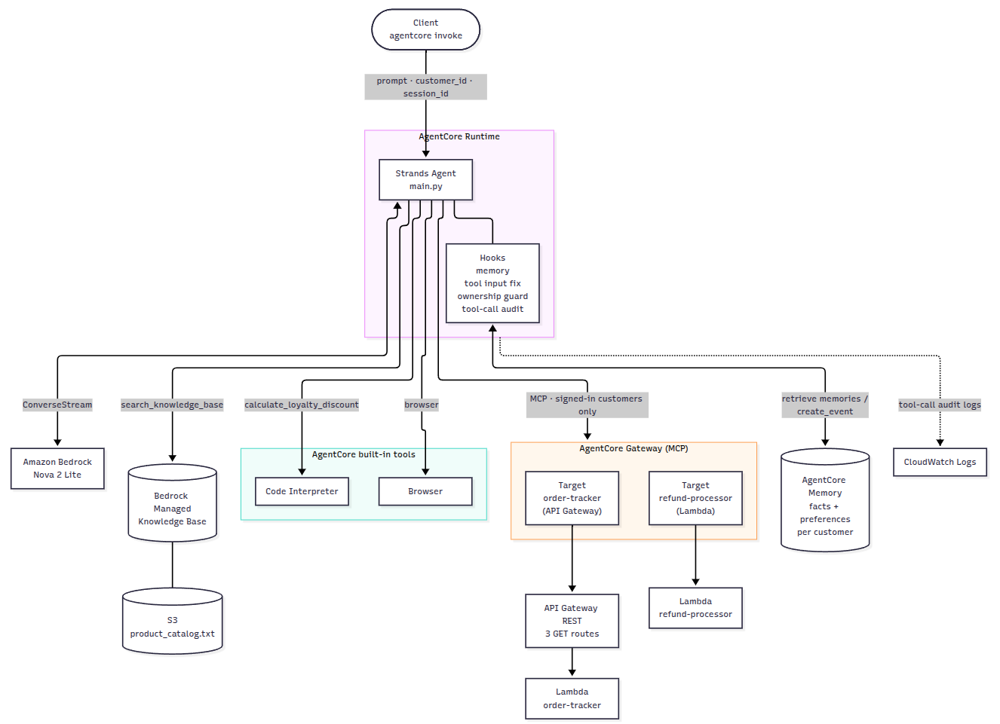

# Customer Support AI Agent on Amazon Bedrock AgentCore

A customer support agent for a fictional Amazon store, built with [Strands Agents](https://strandsagents.com) and deployed to Amazon Bedrock AgentCore Runtime. It answers product and policy questions, tracks orders, processes refunds, remembers customers across sessions, calculates loyalty discounts and reads live web pages.

Final project of Udacity's course *Building Agents with Amazon Bedrock AgentCore and Strands SDK* (AWS AI Engineering Nanodegree), built on the [Udacity project starter](https://github.com/udacity/cd14763-project-starter).

## Features

| Capability | How |
|---|---|
| Product, return policy and loyalty program questions (RAG) | Bedrock Managed Knowledge Base over `product_catalog.txt` |
| Order tracking and customer profile | AgentCore Gateway (MCP) → API Gateway → Lambda `order-tracker` |
| Refunds and return labels | AgentCore Gateway (MCP) → Lambda `refund-processor` |
| Remembers each customer across sessions | AgentCore Memory (semantic facts and user preferences) |
| Exact loyalty discount calculations | AgentCore Code Interpreter |
| Live web pages | AgentCore Browser |

## Architecture



For each request, `invoke()` builds a Strands agent with Amazon Nova 2 Lite and its tools:
- A memory hook prepends what AgentCore Memory knows about the customer and saves every turn.
- Order and refund tools come from the AgentCore Gateway over MCP, and only callers with a `customer_id` get them.
- Tool-call hooks fix arguments the model tends to get wrong, keep Gateway calls within the signed-in customer's own data and log every call to CloudWatch.

## Tech stack

Python 3.13 · Strands Agents 1.63 · Amazon Bedrock AgentCore (Runtime, Gateway, Memory, Code Interpreter, Browser) · Amazon Bedrock Managed Knowledge Base · Amazon Nova 2 Lite · Amazon API Gateway · AWS Lambda · Model Context Protocol (MCP)

## Repository structure

```
starter/
├── main.py                 # the agent (AgentCore Runtime entry point)
├── pyproject.toml          # dependencies, pinned to the tested versions
├── uv.lock
├── setup_permissions.py    # grants the runtime role access to the KB, memory and browser
├── product_catalog.txt     # knowledge base source document
└── lambda/                 # order-tracker and refund-processor Lambdas + refund tool schema
scripts/
├── test_gateway.py         # calls every Gateway tool over MCP, without the model
├── run_tests.py            # runs the six test scenarios and writes docs/test-transcript.md
├── purge_memory.py         # deletes a customer's long-term memory records
├── cleanup.py              # tears down the AWS resources (dry run by default)
└── project_config.py       # shared helpers for the scripts
docs/
├── architecture.png        # architecture diagram
├── test-transcript.md      # evidence of the six tests on the deployed agent
└── console/                # AWS console screenshots of the configuration
```

## Getting started

### Prerequisites

- An AWS account with access to Amazon Bedrock (model `amazon.nova-2-lite-v1:0`) and AgentCore, in `us-east-1`.
- AWS CLI v2, Python 3.13+ and [uv](https://docs.astral.sh/uv/).
- The `agentcore` CLI from the Python `bedrock-agentcore-starter-toolkit`, installed with the project dependencies. Do not install the npm AgentCore CLI as well: both provide an `agentcore` command.

### 1. Create the infrastructure

The [Udacity starter README](https://github.com/udacity/cd14763-project-starter) describes the console steps. This project used these resources (`scripts/cleanup.py` finds them by these names):

| Resource | Configuration |
|---|---|
| Lambdas | `order-tracker` and `refund-processor` (Python 3.12), code from `starter/lambda/` |
| REST API `CustomerSupportAPI` | `GET /orders/{order_id}`, `GET /customers/{customer_id}`, `GET /customers/{customer_id}/orders`, Lambda proxy to `order-tracker`, operation names `get_order`, `get_customer`, `get_customer_orders`, method responses 200/404/500, stage `prod` |
| AgentCore Gateway `CustomerSupportGateway` | NONE authorizer; target `order-tracker` (API Gateway, stage `prod`, with tool descriptions) and target `refund-processor` (Lambda, schema from `starter/lambda/lambda_schema`) |
| AgentCore Memory `CustomerSupportMemory` | Strategies `customer_facts` (semantic, `cs_agent/{actorId}/facts`) and `customer_preferences` (user preference, `cs_agent/{actorId}/preferences`) |
| S3 bucket `customer-support-kb-<account-id>` | Holds `product_catalog.txt` |
| Managed Knowledge Base `CustomerSupportKB` | Data source: the bucket above, synced |

Gateway target names only accept letters, digits and hyphens. Without the method responses, the API Gateway target ends up FAILED. The [console screenshots](docs/console/README.md) show the final configuration.

The NONE authorizer keeps this sandbox focused on tool integration. Do not use it in production, and delete the Gateway when you are done.

### 2. Configure and run locally

Set `GATEWAY_URL`, `KB_ID` and `MEMORY_ID` in `starter/main.py`, then:

```bash
cd starter
uv sync --python 3.13
uv run main.py        # serves /ping and /invocations on port 8080
```

```bash
curl -X POST localhost:8080/invocations -H 'Content-Type: application/json' \
  -d '{"prompt": "Can you track order ORD-001?", "customer_id": "CUST-123", "session_id": "s1"}'
```

`scripts/test_gateway.py` checks the Gateway on its own: it lists the tools and calls each one over MCP, without the model.

### 3. Deploy

From `starter/`:

```bash
uv run agentcore configure --entrypoint main.py --name customer_support_agent \
  --deployment-type direct_code_deploy --runtime PYTHON_3_13 --disable-memory
uv run agentcore deploy
uv run setup_permissions.py
uv run agentcore invoke --session-id "$(uuidgen)" \
  '{"prompt": "Hello, what can you help me with?", "customer_id": "CUST-123", "session_id": "test-1"}'
```

`--disable-memory` only stops the toolkit from creating its own memory; the agent uses `CustomerSupportMemory`.

### 4. Test

From the repository root:

```bash
uv run --project starter python scripts/purge_memory.py CUST-123   # start from a clean memory
uv run --project starter python scripts/run_tests.py
```

### 5. Tear down

```bash
cd starter && uv run agentcore destroy && cd ..
uv run --project starter python scripts/cleanup.py            # dry run: lists what would be deleted
uv run --project starter python scripts/cleanup.py --execute
```

## Results

All six scenarios passed on the deployed agent. The full transcript, with the tool calls taken from CloudWatch, is in [docs/test-transcript.md](docs/test-transcript.md).

| Test | Prompt | Result |
|---|---|---|
| 1. Order tracking | Can you track order ORD-001? | Shipped with UPS, tracking TRK987654321, estimated delivery |
| 2. Refund | Return my Kindle Paperwhite (ORD-002) | Refund REF-H64W1FR2 approved, 3–5 business days |
| 3. Knowledge base | Benefits of the Platinum tier | Free same-day shipping, 15% discount, priority support |
| 4. Memory | Session A: "I am Jane, I prefer concise responses" → session B | Session B recalls the name and the preference |
| 5. Loyalty discount | Gold member, 4,250 points, $150 order | 4,000 points redeemed, 10% tier discount, $99.00 total, 349 points left |
| 6. Browser | Page title of udacity.com | "Learn the Latest Tech Skills; Advance Your Career \| Udacity" |

## Credits and license

Built on the [Udacity project starter](https://github.com/udacity/cd14763-project-starter). The Lambda functions, the refund tool schema, `product_catalog.txt` and `setup_permissions.py` come from the starter unchanged, and `main.py` and `pyproject.toml` were completed from it. Udacity's educational content is licensed under the terms in [LICENSE-UDACITY.txt](LICENSE-UDACITY.txt).
