# AWS console screenshots

Key configuration of the resources created in the AWS console (`us-east-1`) for this project. All resources were deleted after testing, so the IDs, URLs and ARNs shown no longer exist.

## API Gateway (backend of the order tools)

The REST API `CustomerSupportAPI` exposes three GET routes, all proxied to the `order-tracker` Lambda.

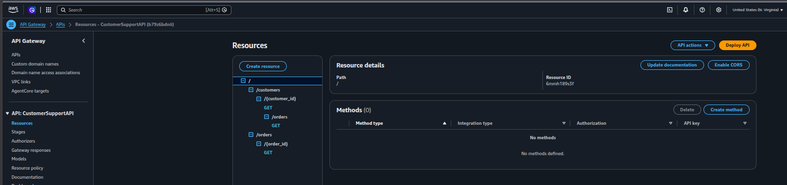

Each method's operation name becomes the tool name the model sees, here `get_order`.

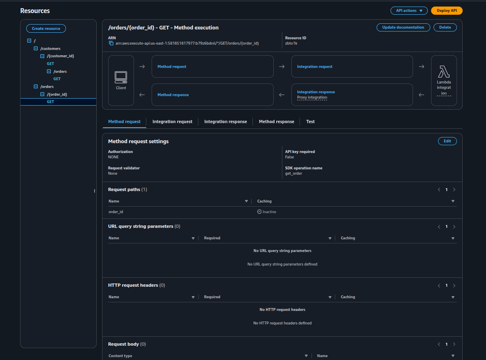

Every GET declares method responses (200, 404 and 500). Without them, the exported OpenAPI spec has no `responses` and the Gateway target ends up in FAILED state.

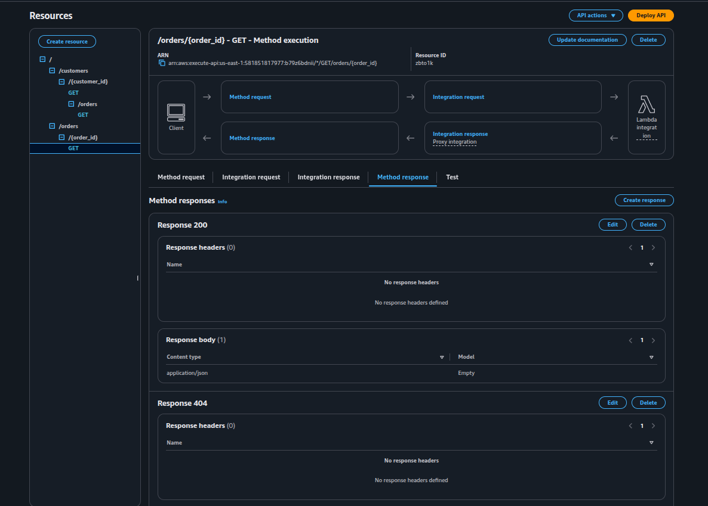

## AgentCore Gateway (MCP)

`CustomerSupportGateway` is ready, with no inbound authorization (NONE authorizer) and semantic search disabled. The agent connects to its `/mcp` URL.

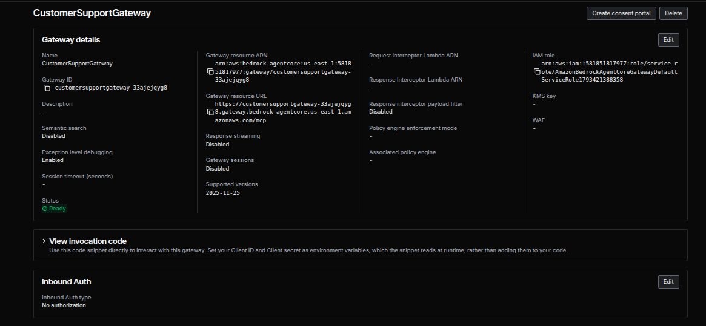

Two targets, one per backend type: `order-tracker` (API Gateway) and `refund-processor` (Lambda).

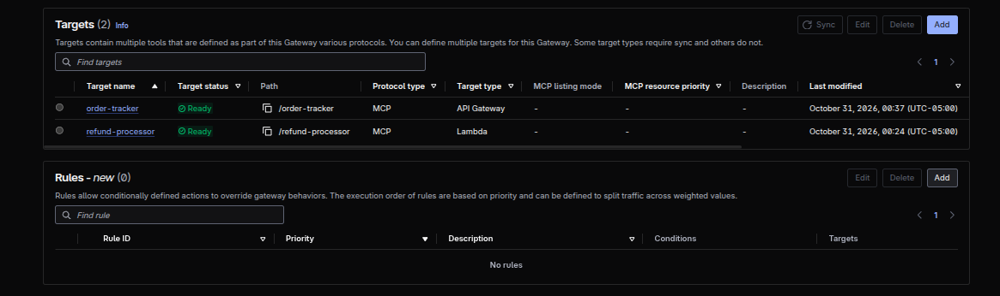

The `order-tracker` target exposes the three GET operations from the `prod` stage, with a name and description override for each tool.

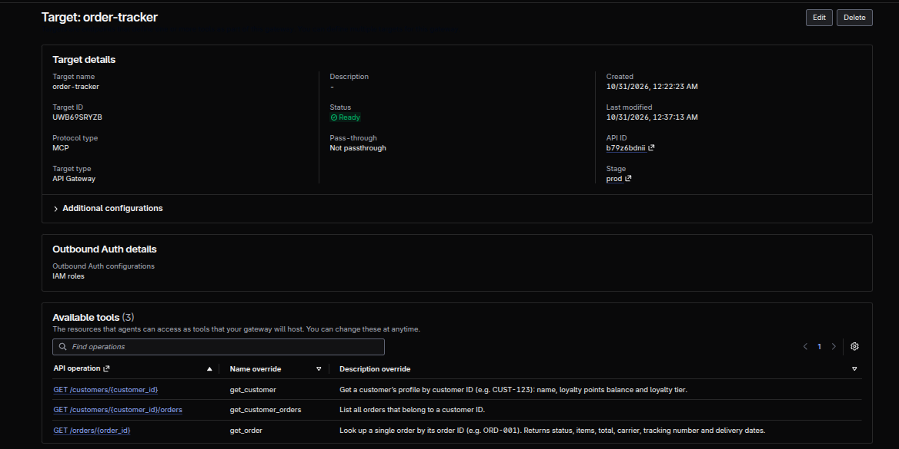

The `refund-processor` target calls the Lambda directly, with its tools defined in an inline schema.

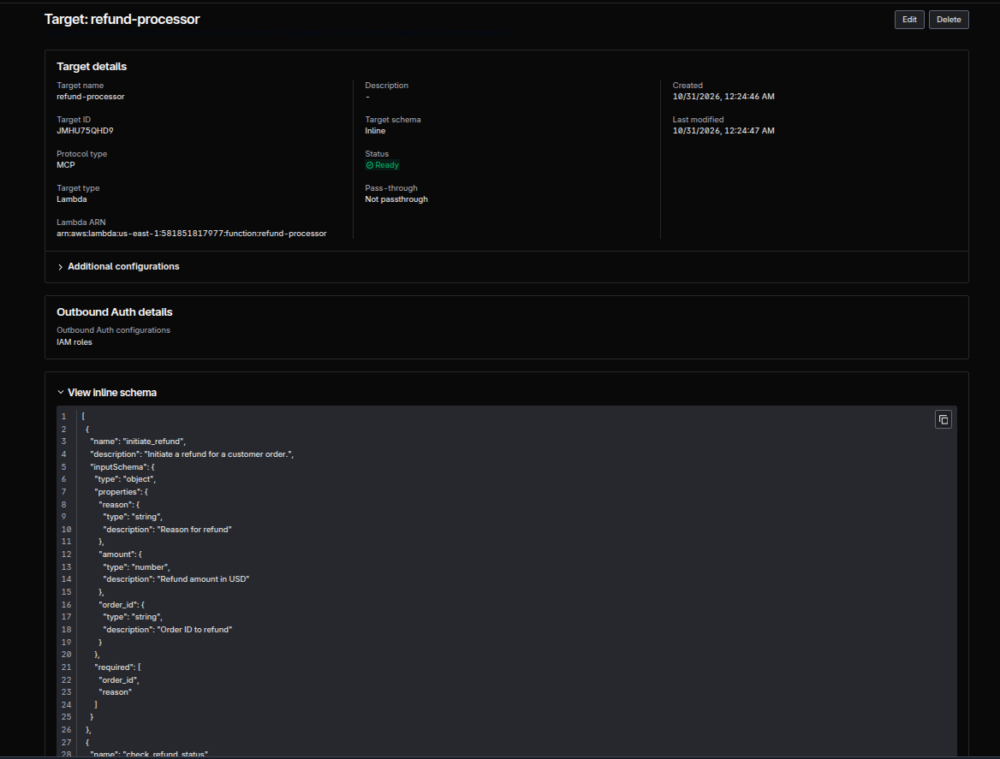

## AgentCore Memory

Two long-term strategies, `customer_facts` (semantic) and `customer_preferences` (user preference), each with a namespace that includes the customer as `{actorId}` (the side panel shows `cs_agent/{actorId}/facts`).

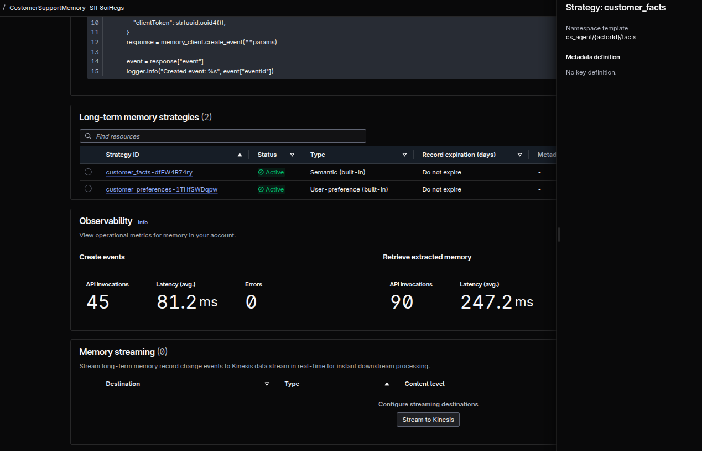

## Knowledge Base

`CustomerSupportKB` is a managed knowledge base (managed vector store and embeddings) with `product_catalog.txt` from S3 as its data source.

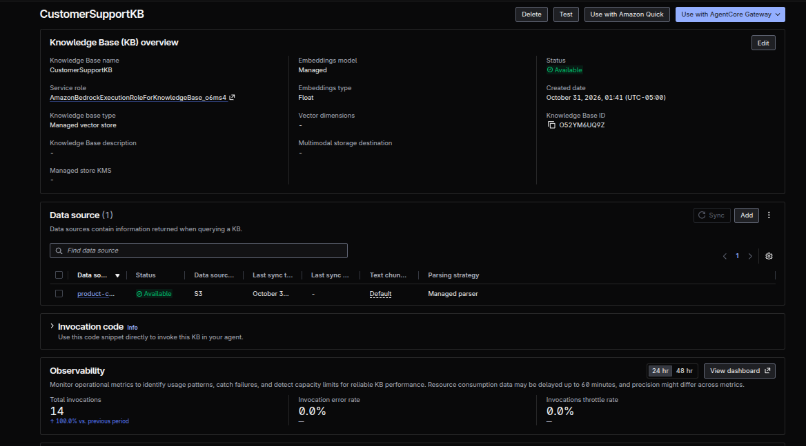

The data source sync completed: 1 document scanned and added, 0 failed.

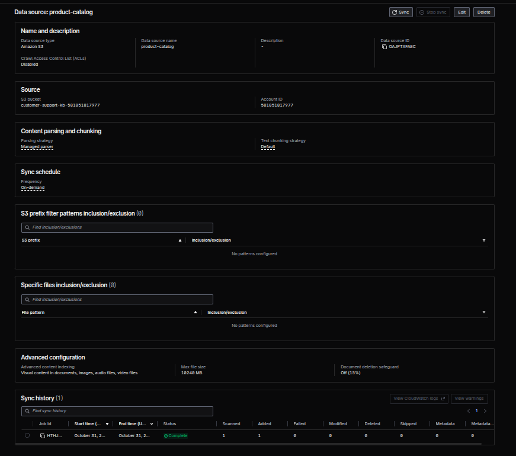

## Runtime and logs

The runtime's execution role has two inline policies: the one created by the AgentCore starter toolkit, and `CustomerSupportIntegrations`, added by `setup_permissions.py` for the knowledge base, memory and browser.

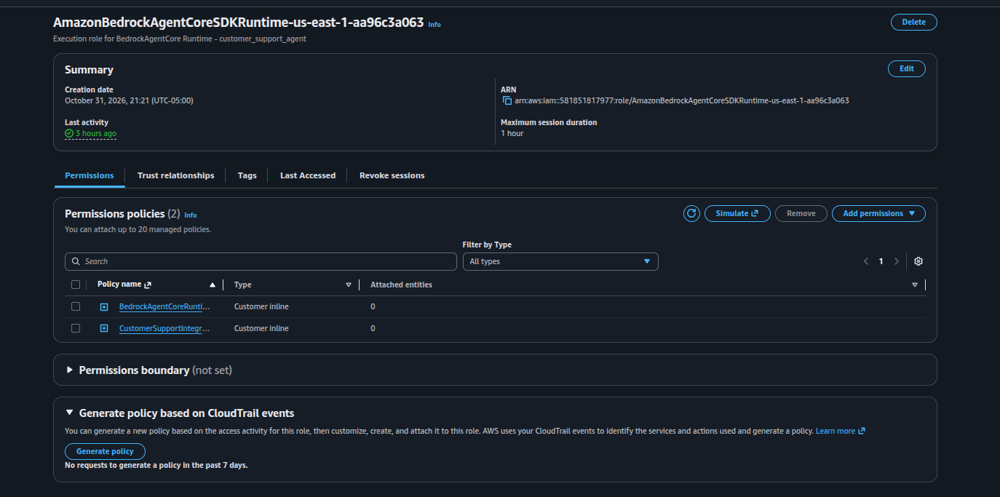

CloudWatch log stream of test 2: the agent calls `get_order` (API Gateway target) and then `initiate_refund` (Lambda target), both with `status=success`.

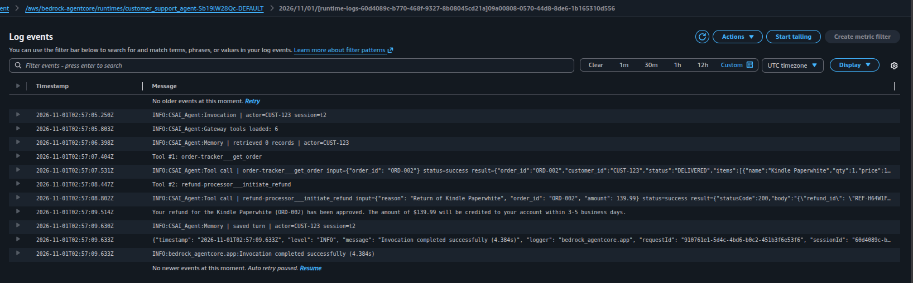
